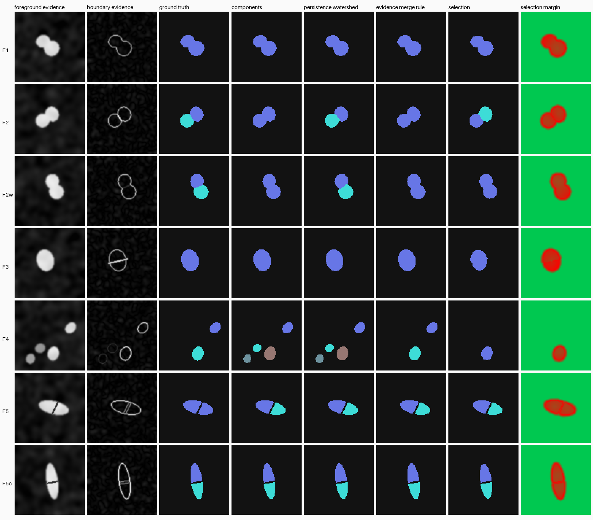

# Object identity: formation and certificates

**Questions.**
- Can topology *propose* objects while evidence *decides* which exist?
- Can an object's existence and membership be **certified** under bounded perturbations, even when the object proposals themselves are recomputed?



*Synthetic scenes, one row per family (F1-F5c, defined under Code). Columns: foreground evidence, boundary evidence, ground truth, connected components, a persistence-seeded watershed, the evidence merge rule, facility-location selection over persistence proposals, and its assignment margin (red = small margin).*

## Run it
CPU only. It needs numpy, scipy, scikit-image and pillow.

```
python demo.py              # about 30 s on one core
python -m unittest discover -s tests
```

## What we found on synthetic scenes (30 per family)
| Finding | Result |
|---|---|
| Topology proposes, evidence decides | Facility-location selection over over-complete persistence proposals merges spurious maxima, splits touching objects that have visible contact evidence, and rejects faint false regions. Pooled object F1 = 0.975 |
| ...but geometry is not what makes it work | A non-geometric rule that merges regions by shared boundary evidence, given the same proposals, is as good (0.989) and more stable across overlapping crops. With identical seeds, geodesic boundaries are no better than a watershed on the boundary evidence |
| Fixed-candidate certificates work once *paired* | Zero violations in 8,464 adversarial perturbations; up to 93% of foreground pixels certified. Unpaired bounds certify almost nothing |
| Recomputed-candidate certificates are sound | Theorem B4: zero violations in 2,920 re-runs of the whole pipeline. But in rigid configurations they certify fewer correct objects than a simple threshold-band certificate (0.23 against 0.63) |
| Open problem | No method certified a correct split of two touching objects. Certifying object births, deaths and splits is the open question |

Theory, assumptions and limits: [docs/theory.md](docs/theory.md).

## Code
- `certified_identity/fixtures.py`: synthetic scene families. F1: one irregular object. F2 / F2w: two touching objects whose contact is visible or faint. F3: one object crossed by a line. F4: objects plus faint false blobs. F5 / F5c: identical evidence, with the truth being one fragmented object or two objects.
- `certified_identity/methods.py`: persistence, baselines, and facility-location selection with geodesic assignment (`select_objects`).
- `certified_identity/certificates.py`: the paired existence and membership certificates, the recomputed-candidate certificate, the threshold-band comparator, and adversarial perturbations.
- `certified_identity/scoring.py`: object F1, error categories and stability measures.
